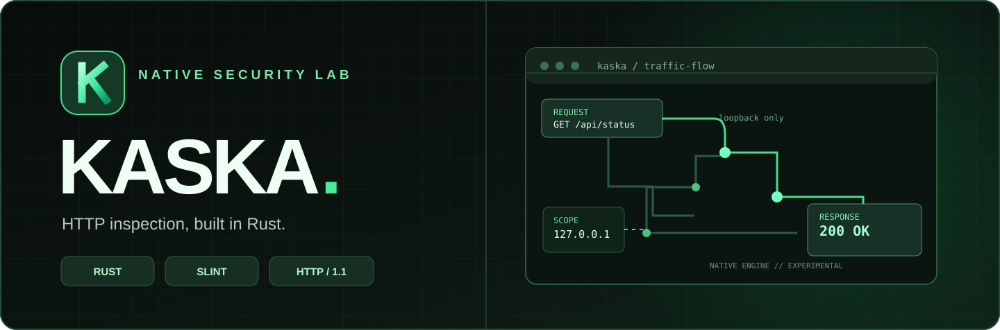
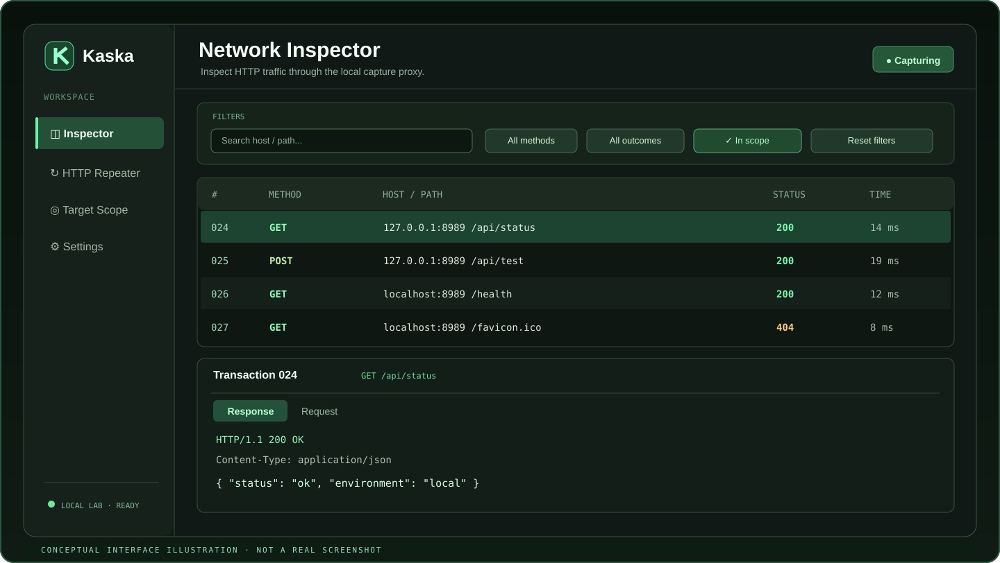
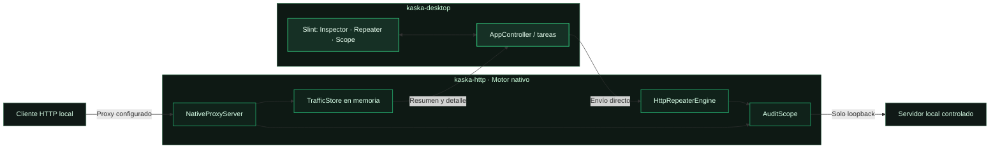
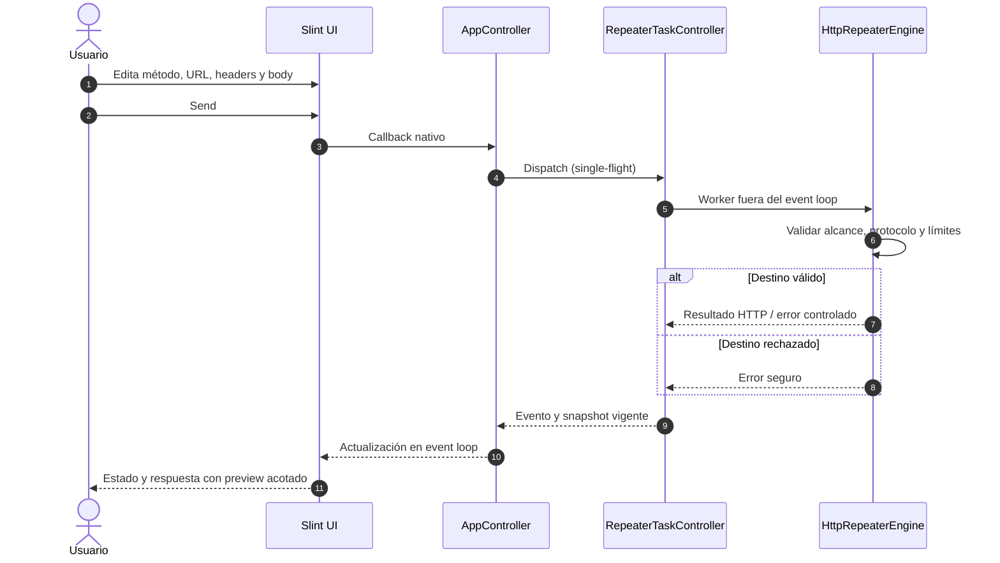

<!-- KASKA README · Documentación visual en main · Capacidades detalladas según develop -->
<p align="center">
  
</p>

<h1 align="center">Kaska</h1>
<p align="center"><strong>Inspección HTTP nativa. Seguridad con límites claros.</strong></p>
<p align="center">
  Una plataforma de escritorio <strong>open source</strong> construida con <strong>Rust + Slint</strong> para estudiar, inspeccionar y repetir tráfico HTTP en laboratorios autorizados.
</p>

> [!NOTE]
> **Ramas y versiones:** este README presenta las funcionalidades integradas en [`develop`](https://github.com/nicolaschiabrandozanotti/Kaska/tree/develop), no afirma que ya estén incluidas en el código histórico de `main`. Para probar Inspector con filtros y Repeater interactivo, cloná `develop`. `main` sigue siendo la rama protegida de releases y puede contener una versión anterior.

<p align="center">
  <a href="https://github.com/nicolaschiabrandozanotti/Kaska/actions/workflows/ci.yml"></a>
  
  
  
  
  
</p>

<p align="center">
  <a href="#inicio-rapido"><strong>Empezar</strong></a> ·
  <a href="#capacidades"><strong>Funcionalidades</strong></a> ·
  <a href="#arquitectura"><strong>Arquitectura</strong></a> ·
  <a href="#seguridad-y-alcance"><strong>Seguridad</strong></a> ·
  <a href="#documentacion"><strong>Documentación</strong></a>
</p>

---

<a id="contenido"></a>
## Explorar Kaska

| Producto | Ingeniería | Proyecto |
|:--|:--|:--|
| [Qué es Kaska](#que-es-kaska) | [Arquitectura](#arquitectura) | [Estado actual](#estado-actual) |
| [Vista conceptual](#vista-conceptual) | [Flujo de Repeater](#flujo-de-repeater) | [Roadmap](#roadmap) |
| [Capacidades](#capacidades) | [Inicio rápido](#inicio-rapido) | [Contribuir](#contribuir) |
| [Seguridad y alcance](#seguridad-y-alcance) | [Pruebas y calidad](#pruebas-y-calidad) | [Licencias y créditos](#licencias-y-creditos) |
| [Demo](#demo) | [Documentación](#documentacion) | [Volver arriba](#kaska) |

<a id="que-es-kaska"></a>
## 01 — Qué es Kaska

Kaska es una aplicación **nativa de escritorio** para Windows y Linux que implementa sus propios motores de inspección de tráfico. Combina una interfaz desarrollada en **Slint** con una biblioteca de red **Rust**, sin Electron ni un navegador embebido como base de la aplicación.

> [!IMPORTANT]
> **No es un wrapper de Burp Suite, Nmap, ffuf o herramientas similares.** El motor HTTP y las capacidades actuales son implementaciones nativas de Kaska. Las ideas de producto futuras no implican que sus funcionalidades ya existan.

Su primera etapa está deliberadamente limitada a **HTTP/1.1 en loopback**, para favorecer pruebas reproducibles, una superficie de seguridad pequeña y un desarrollo incremental.

<a id="vista-conceptual"></a>
## 02 — Vista conceptual

<p align="center">
  
</p>

<p align="center"><sub><strong>Ilustración de diseño, no screenshot real.</strong> Representa la organización general de las vistas; algunos detalles visuales pueden diferir del software ejecutable.</sub></p>

<a id="capacidades"></a>
## 03 — Capacidades en `develop`

| Módulo | Qué permite hacer | Estado |
|:--|:--|:--|
| **Network Inspector** | Revisar solicitudes y respuestas capturadas, métodos, estados, tiempos, cabeceras y cuerpos. Historial volátil y lista virtualizada. | Implementado |
| **Proxy HTTP/1.1** | Capturar tráfico de clientes configurados explícitamente para utilizar el proxy local, con transmisión incremental y límites de inspección. | Implementado |
| **Filtros del Inspector** | Buscar por host/ruta y reducir ruido por método, estado, resultado y pertenencia al scope, sin convertir un filtro visual en autorización de red. | Implementado |
| **HTTP Repeater** | Editar y enviar solicitudes HTTP/1.1 directamente a destinos loopback; inspeccionar respuestas, cancelar cooperativamente y visualizar contenido binario/truncado. | Implementado |
| **Target Scope** | Aplicar validaciones de destino en el backend. La interfaz informa sobre el alcance local permitido. | Implementado, alcance fijo |
| **Inspector → Repeater** | Conversión defensiva de una request capturada a un borrador editable, con políticas de privacidad y validación. | Bridge Rust presente; integración de UX en evolución |
| **Verificación** | Tests, smoke headless con sockets reales, snapshots de UI y pilotos de rendimiento en laboratorio. | Disponible |

> [!NOTE]
> **Experimental / pre-1.0:** el proyecto no ofrece todavía MITM TLS/HTTPS, túneles `CONNECT`, escaneo externo, descubrimiento de hosts públicos ni captura transparente del tráfico del sistema operativo. Tampoco es una herramienta de pentesting integral lista para producción.

<a id="seguridad-y-alcance"></a>
## 04 — Seguridad y alcance

Kaska está diseñada para **educación, CTF, investigación defensiva y auditorías con permiso explícito**. Su restricción de tráfico es parte del motor, no una opción cosmética de la UI.

| Contrato actual | Comportamiento |
|:--|:--|
| **Destinos** | `127.0.0.1`, `localhost`, `[::1]` en un laboratorio bajo control del usuario. Validación antes y después de resolver el destino. |
| **Protocolo** | HTTP/1.1 sin descifrado TLS. |
| **CONNECT** | No hay tunneling; el proxy responde `501 Not Implemented`. |
| **Fuera de alcance** | Las peticiones HTTP hacia hosts no permitidos son rechazadas, sin convertir el filtro de Inspector en regla de acceso. |
| **Privacidad** | Historial de captura en memoria, sin persistencia en disco por defecto. No publicar cuerpos, cookies, tokens o cabeceras sensibles en issues o capturas. |
| **Repeater** | Una operación en vuelo por vez, cancelación cooperativa, límites de tamaños y preview seguro. |

Para reportar una vulnerabilidad del proyecto, seguí [SECURITY.md](SECURITY.md) y utilizá un **reporte privado** mediante [GitHub Security Advisories](https://github.com/nicolaschiabrandozanotti/Kaska/security/advisories), no un issue público con detalles explotables.

<a id="arquitectura"></a>
## 05 — Arquitectura nativa (`develop`)

Dos crates de Cargo separan deliberadamente la presentación del motor de protocolo:

- **`kaska-desktop`**: aplicación Slint, navegación, modelos de UI, `AppController` y coordinación de tareas de Repeater.
- **`kaska-http`**: parser HTTP/1.1, proxy de captura/streaming, `TrafficStore`, `HttpRepeaterEngine`, servidor de pruebas y `AuditScope`. **No depende de Slint.**



**Dos flujos distintos:** el Inspector muestra tráfico que pasa por el proxy; Repeater envía solicitudes **directamente** al servidor loopback y **no las agrega** al historial del Inspector. `AuditScope` permanece como autoridad de seguridad del backend.

<details>
<summary><strong>Ver estructura del workspace</strong></summary>

```text
Kaska/
├── crates/
│   ├── kaska-http/                # Parser, proxy, scope, store y Repeater engine
│   └── kaska-desktop/             # App Slint, controller y bridge
├── docs/
│   ├── architecture.md
│   ├── modules.md
│   ├── development.md
│   ├── accessibility.md
│   ├── ui-design.md
│   └── adr/
├── .github/workflows/ci.yml
├── AGENTS.md
├── CONTRIBUTING.md
├── SECURITY.md
└── Cargo.toml
```

</details>

<a id="flujo-de-repeater"></a>
### Flujo de Repeater — Slint ↔ Rust



<a id="inicio-rapido"></a>
## 06 — Inicio rápido

**Requisitos:** Git, Rust estable (mínimo recomendado 1.85), `rustfmt`, `clippy`, Windows 10/11 x64 con toolchain MSVC o Linux con entorno gráfico y bibliotecas necesarias para Slint.

<details>
<summary><strong>Preparar dependencias en Linux (Ubuntu/Debian)</strong></summary>

```bash
sudo apt-get update
sudo apt-get install -y --no-install-recommends pkg-config libfontconfig1-dev libxkbcommon-dev
```

Se requiere una sesión X11/Wayland activa para abrir la UI. El smoke headless no requiere display.

</details>

<details>
<summary><strong>Preparar herramientas en Windows</strong></summary>

Instalá [Rust con rustup](https://rustup.rs/) y Visual Studio 2022 Build Tools con la carga de trabajo de desarrollo de C++ y el toolchain MSVC x64. Luego, en PowerShell:

```powershell
rustup update stable
rustup component add rustfmt clippy
$env:CARGO_BUILD_JOBS = '2'
```

</details>

**Clonar y ejecutar** (en Windows PowerShell o una terminal Linux, dentro de un directorio de trabajo propio):

```bash
git clone --branch develop https://github.com/nicolaschiabrandozanotti/Kaska.git
cd Kaska
cargo run -p kaska-desktop --locked --jobs 2
```

Kaska abre una ventana nativa. El proxy GUI escucha por defecto en **`127.0.0.1:8080`** y el servidor de pruebas local en **`127.0.0.1:8989`**. Antes de arrancar, asegurate de que los puertos estén libres; la aplicación no configura el proxy global del sistema operativo.

**Para verificar tráfico de laboratorio:** configurá explícitamente tu cliente HTTP para que use `http://127.0.0.1:8080` como proxy y dirigí las solicitudes HTTP a un servicio que controles en loopback. No pruebes hosts públicos: no están autorizados por el motor actual.

<a id="pruebas-y-calidad"></a>
## 07 — Pruebas y calidad

La CI de **`develop`** ejecuta controles en **Windows y Ubuntu**. Podés reproducir la suite sin modificar la configuración global de red:

```bash
cargo fmt --all -- --check
cargo clippy --workspace --all-targets --locked --jobs 2 -- -D warnings
cargo test --workspace --locked --jobs 2 -- --test-threads=2
cargo build -p kaska-desktop --release --locked --jobs 2
```

**Smoke de tráfico HTTP real en localhost**, sin interfaz gráfica (no lo ejecutes simultáneamente con otra instancia en los mismos puertos):

```bash
cargo run -p kaska-desktop --locked --jobs 2 -- --headless-test
```

Hay además arneses reproducibles de snapshots y rendimiento:

```bash
cargo run -p kaska-desktop --example ui_snapshots --locked --jobs 2 -- <directorio-de-salida>
cargo run -p kaska-desktop --example perf_baseline --locked --jobs 2 -- --validate
```

> [!CAUTION]
> `ui_snapshots` necesita sesión gráfica nativa en Windows. Escribí la salida **fuera** del repositorio/worktrees. Las pruebas headless y los snapshots no certifican accesibilidad de lectores de pantalla ni equivalen a una validación gráfica interactiva en Linux.

<a id="demo"></a>
## 08 — Demo y material visual

La imagen superior es **arte vectorial conceptual**. Por el momento el repositorio no incluye una grabación pública verificable de la aplicación ni una galería de capturas reales versionadas; no se utiliza un video externo o una animación inventada como evidencia funcional.

Para reproducir una demostración local, ejecutá la [aplicación](#inicio-rapido), abrí **Network Inspector** y **HTTP Repeater**, y utilizá un servidor propio en loopback. El arnés `ui_snapshots` permite producir evidencia de renderizado; distinguí siempre los snapshots de una grabación real de uso.

<a id="estado-actual"></a>
## 09 — Estado del proyecto

**Experimental · pre-1.0 · desarrollo activo.** La base integrada de desarrollo se encuentra en [`develop`](https://github.com/nicolaschiabrandozanotti/Kaska/tree/develop); [`main`](https://github.com/nicolaschiabrandozanotti/Kaska/tree/main) se reserva para versiones estables. Las capacidades descritas reflejan el estado de desarrollo, no una distribución final para usuarios.

<a id="roadmap"></a>
### Dirección de evolución

| Presente | Próximos incrementos posibles | Futuro sujeto a diseño y autorización |
|:--|:--|:--|
| Inspector, filtros, proxy local, Repeater y herramientas de validación | Refinar UX de Inspector ↔ Repeater, compatibilidad y documentación | Nuevos módulos nativos, ampliación de alcance controlada y funciones de seguridad avanzadas |

Las características futuras **no se anuncian como disponibles**, y la expansión fuera de loopback o hacia HTTPS requiere diseño de seguridad, pruebas y revisión específica.

<a id="documentacion"></a>
## 10 — Documentación técnica

| Documento | Contenido |
|:--|:--|
| [Arquitectura](https://github.com/nicolaschiabrandozanotti/Kaska/blob/develop/docs/architecture.md) | Dependencias, flujo de eventos, límites de memoria y red. |
| [Módulos](https://github.com/nicolaschiabrandozanotti/Kaska/blob/develop/docs/modules.md) | Contratos públicos, responsabilidades y separación Inspector/Repeater. |
| [Desarrollo](https://github.com/nicolaschiabrandozanotti/Kaska/blob/develop/docs/development.md) | Setup de Windows/Linux, ejecución, pruebas y rendimiento. |
| [Diseño de UI](https://github.com/nicolaschiabrandozanotti/Kaska/blob/develop/docs/ui-design.md) | Tema, layouts adaptativos y límites de validación gráfica. |
| [Accesibilidad](https://github.com/nicolaschiabrandozanotti/Kaska/blob/develop/docs/accessibility.md) | Controles implementados y verificaciones todavía pendientes. |
| [ADR](docs/adr/) | Decisiones técnicas y arquitectura documentada. |
| [Seguridad](SECURITY.md) | Uso autorizado y divulgación responsable. |
| [AGENTS.md](AGENTS.md) | Reglas operativas para agentes de código. |

<a id="contribuir"></a>
## 11 — Contribuir

Las contribuciones se trabajan desde **`develop`**, en ramas aisladas (`feature/*`, `fix/*`, `docs/*`...), con commits convencionales, tests y revisión por Pull Request. Consultá [CONTRIBUTING.md](CONTRIBUTING.md) antes de enviar cambios.

Para reportar bugs de uso no sensibles, utilizá [GitHub Issues](https://github.com/nicolaschiabrandozanotti/Kaska/issues). Para vulnerabilidades, **no publiques un exploit en un issue**: seguí el proceso privado de [Security Advisories](https://github.com/nicolaschiabrandozanotti/Kaska/security/advisories).

<a id="licencias-y-creditos"></a>
## 12 — Licencias y créditos

El **código original de Kaska** se distribuye bajo **MIT OR Apache-2.0**: [LICENSE-MIT](LICENSE-MIT) · [LICENSE-APACHE](LICENSE-APACHE). Componentes de terceros conservan sus respectivas licencias; ver [THIRD_PARTY_NOTICES.md](THIRD_PARTY_NOTICES.md).

La interfaz utiliza [Slint](https://slint.dev/) **1.18.1**, desarrollado por **SixtyFPS GmbH**. La distribución del escritorio bajo la modalidad *Slint Royalty-Free Desktop License 2.0* requiere conservar las atribuciones correspondientes; ver las [condiciones oficiales](https://slint.dev/terms-and-conditions) y los avisos del repositorio. Kaska es independiente y **no está afiliado ni patrocinado por Slint / SixtyFPS GmbH**.

---

<p align="center">
  <strong>Native by design. Scoped by default.</strong><br />
  <sub>Rust · Slint · HTTP/1.1 · Open source</sub><br />
  <a href="#kaska">↑ Volver arriba</a>
</p>